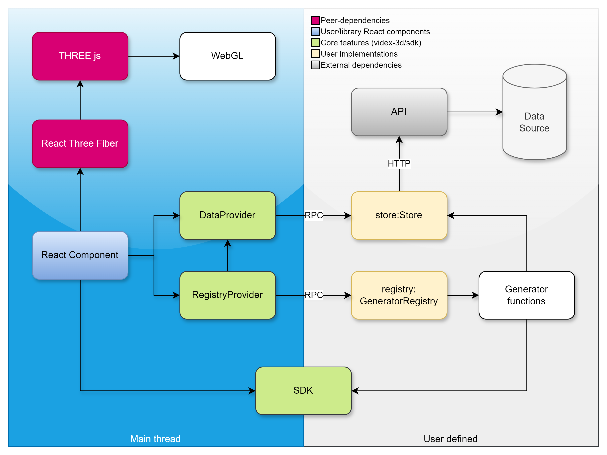

# Architecture
The diagram below illustrates the dependency chain of this library. It is devided into two boundaries, where everything in the blue half is running on the main thread and where the remaining parts may be externalized and executed as separate scripts using web workers if desired. 

The cross-boundary communication is then handled by Comlink through Proxy classes and remote procedure calls.

 

There are two essential React context provider components, which link data and factory methods to other components:

- DataProvider
- GeneratorsProvider

### DataProvider

Provides a data store from which generators or components can access data. The data provider expects an implementation of a store adhering to the `Store` interface:

```ts
type KeyType = string | number

interface Store {
  get: <T>(dataType: string, key: KeyType) => Promise<T | null>
  set: <T>(dataType: string, key: KeyType, value: T) => Promise<boolean>
  all: <T>(dataType: string) => Promise<T[] | null>
  query: <T>(dataType: string, query: Partial<T>) => Promise<T[]>
}
```

Data needs to be organized as named _data sets_ indexed by a key, which may be either a string or a number (typically the id of a data record).

As an example, consider a data set named 'wellbore-headers'. You would then retrieve a wellbore header record from the store by invoking the async `get` function:

```ts
const header = await store.get(
  'wellbore-headers',
  'abcd-1234-efgh-5678-ijkl-9000'
)
```

Specify types are declared for common data types used throughout this library. These are defined in `/src/sdk/data/types` and can be imported from `@equinor/videx-3d/sdk`.

Some examples:
- WellboreHeader
- PositionLog
- Casing
- CompletionTool
- Pick
- StratColumn

**NOTE:** It is important that your source data is mapped properly to these types! All depth data are typically in meters and referenced by MSL (mean sea level).

### GeneratorsProvider

Provides a factory for processing/generating data required in the render loop. This is typically geometry data which it builds based on simple arguments passed by a component depeneding on the generator (such as an id, radius, scale and other option values). The generator code will typically access the store itself to retrieve the data it needs from the data provider.

The components available in this library already have generator functions created that expects certain data sets to be available from the store. These can be imported from `@equinor/videx-3d/generators`.

Generator functions are registered in the `GeneratorRegistry` by adding them to the instance along with a key:

See: [generators](generators.md)

```ts
const registry = new GeneratorRegistry()

registry.add('generator name', myGeneratorFunction)
```

Generators are typically dependant on the data context, and the `GeneratorsProvider` must therfore be added as a child of the `DataProvider`:

```tsx
<...>
<DataProvider store={store}>
  <GeneratorsProvider registry={registry}>
    {/* Add any components depending on data/generators here */}
  </GeneratorsProvider>
</DataProvider>
</...>
```

Where `store` is an implementation of the `Store` interface and `registry` is an instance of the `GeneratorRegistry` class.

As with data set names, existing components depends on generators available in the registry with specific key names. For example, the `BasicTrajectory` component will depend on a generator named `'basicTrajectory'`. These names are declared and exported with the components, and you will find which dependencies each component have in the api docs.

### SDK
The SDK (software development kit) contains supporting functions and classes, which can be imported from `videx-3d/sdk`. This contains data type definitions, utility functions and other shared code, which may be used across boundaries. 

### Depth buffers

Every component works with whichever depth buffer the host's renderer has:

- **linear**: three's default; depth 0 at the near plane, 1 at the far one;
- **logarithmic** (`logarithmicDepthBuffer`): written per fragment from the distance, for the
  range of scales a field view needs (centimetres to thousands of kilometres). The stories use it;
- **reversed** (`reversedDepthBuffer`, needs `EXT_clip_control`): depth 1 at the
  near plane, 0 at the far one, clip z from 0 to w. three turns every camera it draws with to
  a reversed projection on its first render (`camera.reversedDepth`), by its
  `updateProjectionMatrix`.

Logarithmic and reversed together are not supported: three's own log-depth shader chunk has
no reversed form, so its materials break with both on.

Most code needs none of this: three's chunks and its depth test handle it. Code that does
depth by hand must handle all three:

| What | Shader side (`sdk/materials/shaderLib/depth.glsl`) | CPU side (`sdk/utils/depth-buffer.ts`) |
|--|--|--|
| Something drawn on the far plane (the sky's background) | `DEPTH_FAR_NDC` | |
| Vertices held inside the far plane (fp32 rounds far-off clip z past it) | `depthInsideFarClip` | |
| A depth written (`gl_FragDepth`) for a point other than the fragment's own | `depthOfView`, `depthInsideFar` | |
| A depth read from the depth buffer and compared or converted | `depthToStandard` (reversed: `1 - depth` is the linear depth of the same point) | |
| A frustum built from a projection, for culling | | `setFrustumFromMatrix` |
| A projected NDC z tested against the view's range | | `standardNdcZ` |
| An offscreen pass drawing in clip space with its own camera | | `createClipSpaceCamera` (a plain `Camera` has no `updateProjectionMatrix`, which three calls) |
| A projection changed and restored around a render (jitter) | | compare `isReversedDepth` before and after: three may rebuild it in between |

Notes:

- three defines `USE_LOGARITHMIC_DEPTH_BUFFER` and `USE_REVERSED_DEPTH_BUFFER` for a
  `ShaderMaterial`; a `RawShaderMaterial` gets neither and must be told by a uniform (the TAA
  resolve's `logDepth` and `reversedDepth`).
- three declares `projectionMatrix` for the vertex shader only. A fragment shader that writes
  a depth from it (`depthOfView(projectionMatrix, …)`) declares `uniform mat4 projectionMatrix;`
  itself; three sets it by name.
- What a pass draws with `createClipSpaceCamera` must lie at clip z 0, inside both the
  standard range (-w to w) and the reversed one (0 to w).
- To check a change, switch the storybook's canvas (`canvas-3d-decorator.tsx`, its `gl`
  props) to each of the three and look for shader errors in the console as well as at the
  picture: a branch for one buffer only compiles with it.

