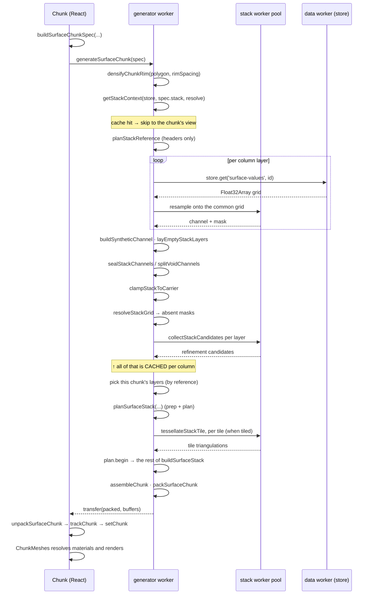
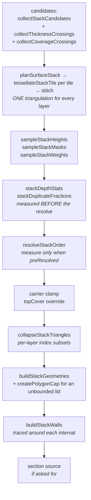

# The build pipeline

From `<Chunk layers={...} />` to triangles. Every stage, in order, with the
function that runs it and what it scales with.

- [Overview](#overview)
- [Stage 1 — the spec (main thread)](#stage-1--the-spec-main-thread)
- [Stage 2 — the shared column (worker)](#stage-2--the-shared-column-worker)
- [The shared column cache](#the-shared-column-cache)
- [Stage 3 — the chunk's own view](#stage-3--the-chunks-own-view)
- [Stage 4 — buildSurfaceStack](#stage-4--buildsurfacestack)
- [Stage 5 — assemble, pack, transfer](#stage-5--assemble-pack-transfer)
- [Stage 6 — back on the main thread](#stage-6--back-on-the-main-thread)
- [The worker pool](#the-worker-pool)
- [Superseded builds](#superseded-builds)
- [Invariants worth knowing](#invariants-worth-knowing)

---

## Overview



The two boxed regions are the whole story of the cost model:

- Everything down to the candidates scales with **reference grid nodes × layers**
  and is paid **once per column**.
- `buildSurfaceStack` onward scales with **shared tessellation vertices × layers**
  and is paid **per chunk**. At field scale, this second group dominates.

See [sampling-and-perf.md](./sampling-and-perf.md#the-cost-model).

---

## Stage 1 — the spec (main thread)

`buildSurfaceChunkSpec(layers, utmToArea, outlinePolygon, options)` →
`SurfaceChunkSpec`.

Pure, synchronous, and deliberately tiny. It produces **plain data only**: no
class instances, no `Material`, no `Float32Array` grids. `PlanarPolygonGeometry` is
flattened to `{ coordinates, offset }` and reconstructed in the worker.

What it does:

1. Maps each layer to a spec layer — either
   `{ id, header, referenceDepth, worldPosition }` (from `SurfaceMeta`) or
   `{ depth, offset, relief }` (synthetic), plus `fill`, `cap` and `capCuts` from
   the seam decision.
2. **Infers the carrier layer**: if the stack declares a `carrier` and the *last*
   layer has a `fill`, a `{ carrier: true, fill: false }` layer is appended.
3. Collects the neighbours' footprints referenced by `capCuts` into `cuts`, each
   carrying **its owner's `rimSpacing`** — densifying it differently would put the
   two boundaries on different points of the reference grid and the seam would open
   a hairline crack.
4. Builds the column spec via `stackColumnSpec`, whose `key` is
   `orderedSurfaceIds | carrierDepth/carrierBelow`.

> ⚠️⚠️ **Everything built from the same column must derive that key here.** The
> cache is keyed by it, so two callers asking for the same column under different
> names pay for the fetch, the resample and the resolve twice, and hold two copies.
> This is why `buildStackWaterSpec` calls `stackColumnSpec` too.

The spec is memoised on its inputs, and the build **token** rides outside it
(`{ ...spec, build: { key, token: ++n } }`) on purpose: the token changes on every
request, and putting it in the memo would churn it.

---

## Stage 2 — the shared column (worker)

`getStackContext(store, stack, resolve)` in
`src/generators/surface-stack-context.ts`. On a cache miss it runs
`buildStackContext`:

| # | Step | Function | Notes |
|---|------|----------|-------|
| 1 | Plan the common grid | `planStackReference` | headers only — no grids fetched yet |
| 2 | Fetch + resample, pipelined | `store.get` → `resampleStackChannel` | each layer is resampled as soon as its own grid lands, on the pool |
| 3 | Synthetic channels | `buildSyntheticChannel` | `depth` / `offset` / `relief` |
| 4 | Empty layers | `layEmptyStackLayers` | see the sentinel trap below |
| 5 | Carrier level | `stackCarrierLevel` | `{below}` is measured from the deepest **mapped** sample |
| 6 | Seal | `sealStackChannels` or `splitVoidChannels` | once, for the whole column |
| 7 | Clamp to the carrier | `clampStackToCarrier` | elementwise `max`, order-preserving |
| 8 | Depth order | `resolveStackGrid` | elementwise `min` cascade → per-node `absent` masks |
| 9 | Clamp again | `clampStackToCarrier` | a positive `minGap` could otherwise push the floor below what it just truncated |
| 10 | Refine | `getStackCandidates` → pool → `collectStackCandidates` | cached alongside the column |

### The common grid

`planStackReference` picks the **finest** layer's grid (smallest `xinc × yinc`) so
no layer is resampled *up*, crops it to the envelope, and decimates by an integer
`step` if the crop exceeds `maxNodes` (`DEFAULT_STACK_MAX_NODES` = 4,000,000).
Every layer is then bilinearly resampled onto it, expressed in **scene Y**
(`y = value − referenceDepth`).

`StackReference`:

```ts
{
  header: SurfaceClipHeader;   // nx, ny, xinc, yinc, rot of the common grid
  worldPosition: Vec2;         // scene XZ of node (0,0)
  channels: Float32Array[];    // per layer: scene Y at every node
  masks: Uint8Array[];         // per layer: coverage
  step: number;                // source cells per reference cell
}
```

Masks are **tri-state**, and every consumer tests them for truthiness so the
distinction costs nothing downstream:

| Constant | Value | Meaning |
|----------|-------|---------|
| `STACK_MASK_NONE` | 0 | no extent here |
| `STACK_MASK_DATA` | 1 | real data from the layer's own grid |
| `STACK_MASK_FILLED` | 2 | no data of its own, but within `maxFill` metres of some — counted as covered, reported as fill |

Holes and past-the-edge regions are filled from the nearest real sample with a
two-sweep chamfer transform (`chamferFill`), so the grid has no cliffs for the
triangulator to chase. **Values are always filled; what `maxFill` bounds is the
MASK.** See [outlines.md](./outlines.md#bounded-fill).

> ⚠️ **The `-1e30` pillar.** `STACK_NO_DATA` is the channel sentinel. A layer with
> data *nowhere* has nothing to fill from, so its channel would keep the sentinel
> and produce a surface at Y = −1e30 — a wall reaching to infinity. `layEmptyStackLayers`
> copies such a layer's channel from its nearest mapped neighbour (zero thickness,
> so the collapse drops it) while leaving its **mask** empty so the diagnostics
> stay truthful. Any caller can hit this with a survey that misses the footprint
> entirely.

### What is cached

`StackContext` holds, per column:

| Field | Space | Meaning |
|-------|-------|---------|
| `reference` | expanded | channels + masks over the common grid |
| `layers` | column | the fetched `StackLayer`s |
| `index` | column | surface id → layer index |
| `expansion` | column → expanded | 1 entry normally, 2 where a void split a layer |
| `ceiling` | expanded | is this the upper copy of a void |
| `carrier` | **column** | index of the carrier layer, or null |
| `absent` | expanded | per-node truncation masks from `resolveStackGrid` |
| `inferred` | expanded | per-node seal weights, or null when unsealed |
| `tapered` | column | node counts the seal moved |
| `pairs` | expanded | per-adjacent-pair crossing statistics |
| `bytes`, `retainedBytes`, `fetchMs`, `referenceMs`, `sealMs`, `resolveMs` | | accounting |

> ⚠️⚠️ **Column space and expanded space coincide until something splits.** Under
> `sealMode: 'proportional'` nothing splits, so an index mistake here passes every
> test and only breaks under `'void'`. Two such slips have shipped. When touching
> this code, check which space each array is in — the table above is the reference.

---

## The shared column cache

- **Four entries, least recently used evicted** (`MAX_CACHED_COLUMNS`). The
  channels are the heaviest thing the library holds — nodes × layers × 4 bytes,
  hundreds of MB at field scale — so a few columns is the most that is affordable.
- **Key** = `stack.key` (ordered surface ids + carrier) `|` `resolve.mode` `|`
  `minGap` `|` `maxNodes` `|` `maxFill` `|` *resolve present* `|` `seal` `|`
  `sealMode` `|` `minThickness`.
- **Hit** → the cached promise is returned; concurrent chunks await the same
  in-flight promise.
- **Miss** → a new build is chained after the current one (column builds are
  serialised) and becomes the cached entry, evicting the old.
- **Released** by the `stackRelease` generator (`releaseStackResources`), which
  `ChunkStack` invokes on unmount — through a ref, so a change of callback identity
  cannot throw the column away mid-session.
- **What chunks derive from it is kept with it too** (`getStackDerived` /
  `keepStackDerived`): each layer's data-edge crossings and, per layer set, the
  simplified pinch-out lines — together about 1.2 s of every build of a 33-layer
  field. See [Derived from the column alone](#derived-from-the-column-alone).

`generatorStats()` reports `columnKey`, `columnBytes`, `candidateBytes`,
`columnsBuilt`, `columnsInFlight`, `poolSize` and (in Chrome) the V8 heap.

---

## Stage 3 — the chunk's own view

With a column, the chunk does **not** copy anything. It picks its layers out of the
column by index and takes the channels **by reference**:

```
column layers  :  [ 0  1  2  3  4  5  6 ]        ← ChunkStack.surfaces (claimed)
expansion      :  [[0][1][2,3][4][5][6][7]]      ← a void split layer 2
chunk picks    :        2  3  4                  ← this chunk's surfaces
                        ↓
built layers   :  [ ceiling(2) floor(2) 3 4 carrier ]
source[]       :  [    2         2      3 4   5    ]  ← back to the CALLER's layers
```

Assembled in **one loop** pushing to all seven parallel arrays together —
`channels`, `masks`, `source`, `ceilings`, `inferred`, `candidates`, `preResolved`
— deliberately, so they cannot drift. `source[]` is what keeps
`SurfaceChunkMesh.layer` indexing the *caller's* layers, so materials keep
resolving.

Three per-chunk decisions are made here:

- **`chunkCopies`** — which copies of a split layer this chunk draws. A ceiling
  *always* travels with its floor: the collapse drops a ceiling by comparing it
  with its own floor copy, so a chunk given the ceiling alone would draw it over
  the whole footprint and fight the horizon its seam owner draws.
- **`caps` / `capCuts`** — from the seam decision, except that a **void ceiling is
  capped** by the chunk holding the interval above it: the seam assigns the shared
  *horizon* (the floor copy), while a ceiling exists only inside the void.
  ⚠️ Only while that interval is FILLED. Under a gap the ceiling closes nothing and
  would float in it as a lens, so it stays a boundary and draws no cap.
- **`fills`** — derived rather than passed down: `fills[k] = !ceiling[k] &&
  loaded[source[k]].fill && !voided`. A ceiling holds no volume, which is what
  makes the void below it a void.

### When `preResolved` cannot be used

The column's per-node `absent` masks are dropped, and the per-vertex resolve runs
instead, when the chunk has a **synthetic layer** (the column never saw it) or when
the column was **sealed**.

> ⭐ The second reason is subtle and was a real defect. The column's masks are
> perfectly valid — they are just decided at **grid nodes**, while a triangle is
> dropped only when **all three of its own corners** are marked. An island of
> marked *vertices* can never remove anything; an island of marked *nodes* spans
> cells and takes whole triangles with it, punching walled notches into the cap.
> Sealing leaves surfaces running a metre apart over wide bands, which is exactly
> what produces those islands.
>
> **A decision taken at grid nodes and one taken at shared vertices are not
> interchangeable.**

---

## Stage 4 — buildSurfaceStack

`buildSurfaceStack(reference, layers, options)` in
`src/sdk/geometries/surface-stack-geometry.ts` is **the** entry point. The
individual steps are exported too, but they must be run in this order and with each
other's outputs — resolving without collapsing, in particular, leaves welded
duplicate surfaces behind, which is the one thing a shared tessellation still
z-fights on.



### Candidates

The height refinement knows each surface only on its own, so it puts no vertices
where two of them converge or where one runs out of data. Two extra passes fix
that, merged into the union:

- `collectThicknessCrossings(above, below, nx, threshold)` — the line where a unit
  wedges out (`refineTerminations`, on only when `constrainTerminations` is off;
  a chunk constrains by default, which puts the line itself into the mesh).
  Majority-voted over the
  4-neighbourhood first, because the raw test speckles where two surfaces run
  nearly parallel a hair apart.
- `collectCoverageCrossings(mask, nx)` — the edge of a layer's own data
  (`refineCoverage`, default on, but **off** when `constrainCoverage` is on).
  Deliberately *without* the vote: a one-node thickness flicker is noise, a
  one-node coverage hole is data.

Coverage refinement is the one a **sealed** stack needs: a sealed surface keeps full
thickness either side of its data edge, so that edge is not a thickness crossing and
nothing else would put vertices on it — the taper would then start wherever the
height refinement happened to leave a vertex, hundreds of metres inside the data.

### tessellateStack

Inputs: the reference, the **densified** polygon, `maxError`, the candidate union,
the neighbours' `cuts`, and `constrainCoverage`.

- Candidates are **inserted** (forced insertions, not a pool), filtered to the
  chunk's footprint dilated by one cell — exact, because the rim is a constraint
  edge and flips never cross one, and un-dilated it drops nodes lying exactly on
  the rim.
- The **rim** is inserted and **constrained**. So are the `cuts` and, when asked,
  each layer's traced mask boundary — as *open chains* that do not extend the kept
  domain.
- Exterior triangles are removed, the rest are put in **Morton order** of their
  centroids (`sortTrianglesSpatially`), and the vertices are compacted in that
  order. Every layer's kept subset inherits it, which cut transparent GPU time by
  about a quarter (chunks.md §16.8).
- Per-cut and per-coverage triangle membership is decided by **centroid**, which is
  exact precisely because the ring is constrained.

Returns `StackTessellation`: `coords`, `indices`, `rimVertices`, optional `cuts` /
`coverage` flags, plus `rimDropped`, `coverageRingPoints` and
`constraintFailures` — the last should always be 0.

> ⚠️ **Do not simplify the coverage rings.** Ramer–Douglas–Peucker makes a
> rectilinear traced ring cross *itself* where two staircase arms pass within the
> tolerance, and the noder skips same-ring pairs — so the constraint is silently not
> enforced.

### Tiled tessellation (`tileCells`)

`ChunkResolveOptions.tileCells` (→ `SurfaceStackOptions.tileCells`) triangulates
the chunk in square tiles of that many **reference-grid cells**, joined along their
seams into one mesh. Omitted (or 0), the chunk is one triangulation. It is not part
of the column's cache key, so changing it rebuilds the chunk only. The tiles are
the unit the planned LOD will switch detail by.

The build is split where the tiles are, the same way the caps already are:

```
planSurfaceStack(reference, layers, options)   → { tiles, begin, terminationLines, coverageCrossings }
  tiles.map(tessellateStackTile)              ← anywhere: three.js-free, plain data in and out
  begin(outputs)                              → SurfaceStackPending (jobs → finishCap → finish)
```

`beginSurfaceStack` and `buildSurfaceStack` do exactly that on the current thread;
the generator runs the tiles on the pool (`tessellateStackTiles`).

**How the seams stay closed.** `planStackTessellation` does everything that
needs the whole chunk, once:

- Seams run on **half-cell lines** (`k · cells − 0.5`), so no grid node, and no
  traced data boundary (which follows cell edges), can lie on one. The outer tiles
  reach the grid's edge.
- Each seam is an open polyline — its ends, the seams crossing it, and the
  positions its own height profile needs (`refineStackSeam`: a per-layer
  Douglas–Peucker of the profile, kept positions unioned over layers; nothing else
  refines a boundary). It is **noded with every other ring**, so where the rim, a
  cut, a data edge or a pinch-out line crosses a seam there is ONE point.
- A ring point within the noder's touch distance (`GRID_NODE_TOUCH`) of a seam is
  put exactly on it, as a copy — a rounding error off a seam would otherwise land
  inside one tile and on the other's boundary.
- Every point on a seam is inserted **first** by **both** tiles beside it. Each
  tile's Delatin is bootstrapped on its own rectangle (`new Delatin(…, bounds)`), so
  the shared side is its convex hull and the two sides are the same chain of edges.
  A constraint running along a seam is skipped: it is that boundary already.
- Each tile then inserts its refinement nodes, its pieces of the rim (all inserted
  before any is locked) and its pieces of the cuts, data edges and pinch-out lines;
  trims to the outline; and sorts its triangles in Morton order.
- `stitchStackTiles` joins them, merging vertices **by exact coordinate, and only
  on a seam**. Vertices are numbered tile by tile, so the spatial order is Morton
  inside a tile and row-major between tiles.

> ⭐ **One tile is the untiled build, byte for byte.** That is a test, and it is
> what makes the tiled path safe to have as the only path.

What it costs, measured on a 33-layer field (troll, warm builds, 8 workers):

| `tileCells` | Tiles | Shared triangles | Tessellation (ms) |
|---|---|---|---|
| off | 1 | 459,268 | 4,645 |
| 128 | 40 | 465,372 (+1.3 %) | 3,813 — one tile is the critical path |
| 64 | 160 | 471,578 (+2.7 %) | 3,006 — 2,317 once the column has the derived results |

The extra triangles are the seam vertices. Constraint failures are 0 throughout.
Where the rest goes is reported per build in `SurfaceChunkDiagnostics.tessellation`
(`prepMs`, `planMs`, `tilesMs`, `tileWorkMs`, `slowestTileMs`, `stitchMs`,
`tiles`; in the story's `CHUNKREPORT` as `tessPrepMs` … `tiles`).

> ⚠️ **What is left is serial.** At 64 cells the tiles take ~0.5 s and the plan
> ~1.3–1.6 s, of which noding every ring is ~0.66 s and cutting them into tile
> pieces ~0.22 s. Noding and cutting per tile, on the pool, is the next step if it
> is needed — it changes how a seam gets its shared points.

> ⚠️ **Compare timings within one session.** Every phase moved by ~30 % between
> sessions on the same machine and data, which is larger than most of the changes
> being measured.

**Seeing the tiles.** `debugTiles` on `Chunk` or `ChunkStack` (appearance only —
no rebuild) tints every surface by tile and draws the seams: with a checker, or —
while a level of detail is chosen per tile — by that level, green at full detail
through yellow to red at the coarsest.
`SurfaceChunkMetrics.tiling` describes the layout (`cells`, `first`, `count`, and
`toGrid`, the affine map from scene XZ to grid column/row); `createTileUniforms`
turns it into the uniforms `ChunkMaterial` reads through its `tiles` parameter
(`CHUNK_TILE_DEBUG`). They include one value per tile (an R8 texture) and
`byValue`, which switches the tint from the checker to that value.

### Derived from the column alone

Two inputs to the plan depend on the column's channels and nothing else, and cost
about 1.2 s on a 33-layer field:

- each layer's **data-edge crossings** (`collectCoverageCrossings`), when
  `refineCoverage` is on;
- the **pinch-out lines** per adjacent pair, simplified against every layer of the
  chunk (two thirds of that time is reading 33 heights at each of ~400 k traced
  points). That needs every channel, so it cannot go to the pool.

The plan hands back what it derived (`SurfaceStackPlan.terminationLines` /
`.coverageCrossings`) and takes it in again (`SurfaceStackOptions.terminationLines`
/ `.coverageCrossings`). The generator keeps it with the column:

- a data edge by the **identity of the mask**, a set of pinch-out lines by the
  column index of every channel (by identity) plus threshold and `maxError`;
- so a voided or synthetic layer, whose arrays are made per build, never matches;
- in a `WeakMap` keyed by the column, so it goes when the column does; the lines
  packed into typed arrays, at most four layer sets per column;
- a hit also skips the pinch-out scan on the pool. It is not counted in
  `generatorStats`.

The first build of a column gains nothing; every later one, and every other chunk
of the column drawing the same layers, skips the work.

### Coarser levels of detail (`lod`)

`ChunkResolveOptions.lod = { levels, factor }` (→ `SurfaceStackOptions.lod`)
builds `levels` coarser triangulations of the same stack in the same build, level
`k` simplified to `maxError × factor^k`. Each cap then carries one index per level
(`SurfaceChunkMesh.levels`) over its own attributes. `lodLevel` on `Chunk` /
`ChunkStack` (appearance only) draws every cap at one level, to judge them;
otherwise `useChunkLod` picks one per tile from its error on screen
(`lodPixelError`), and culls buried caps (chunks.md §16.7).

What a level keeps and what it thins:

- **Kept exactly:** the rim, cuts, data edges and every seam point, so a tile at
  any level meets its neighbour at any other (a test checks the seam edges are the
  same in every level).
- **The full level's outline, at every level:** the walls are built along it, so
  each tile hands its coarser levels every point on its own outline — a grid node
  lying ON the rim included, which no level's refinement would otherwise keep. A
  thinned line can still cross the rim somewhere new; such a vertex lies on an
  edge of the full outline and takes its height along that edge
  (`StackTessellation.outlineBlends`), so a coarse cap's edge runs exactly along
  the top of the wall.
- **Refinement nodes, nested for free:** `collectStackCandidateLevels` records,
  per node, the running minimum of the mesh error at its insertion. The nodes with
  a level above `E` are exactly what refining to `E` gives, so one refinement
  serves every level. A node added for a line (thickness or data-edge crossings)
  is kept at every level.
- **Pinch-out lines, thinned:** each tile piece (its ends fixed on a seam or the
  rim) is simplified by `thinChain` — Douglas–Peucker in plan to
  `max(0.5 cell, E / cell size)` and then in height to `E` against every layer,
  from heights the plan samples per point. A piece that would cross itself stays
  whole. Thinned lines cross where the full ones did not, so each tile nodes its
  pieces again (`nodeGridRings`, now three.js-free in `grid-noding.ts`).
- **Vertices:** a level adds those it alone uses (where thinned lines cross)
  after the full level's, so every per-vertex array covers both.
- **Patches per level:** with `peelable`, each level's collapse also emits its
  peel set, and a cap carries that level's patch (`patchLevels`: peel set minus
  kept) with its own tile starts (`patchTileStarts`), so a peel or a kept unit
  draws the patch at each tile's level (chunks.md §15.12).
- **Normals: the attribute at full detail, a map on coarser tiles:** a
  full-detail vertex normal stretched over a coarse triangle shades as a dark
  smear beside every steep channel. So a build with levels also bakes each cap's
  normals into a map (`bakeCapNormalMap`, `cap-normal-map.ts`): RG half floats
  (x and z, y rebuilt) on a grid of `CAP_NORMAL_MAP_CELLS` (1) reference cells
  per texel, its texel centres on grid nodes. A texel inside a full-level
  triangle gets the vertex normals interpolated there; one only a coarser level
  covers gets that level's; a sliver with no texel centre still marks its nearest
  texel, and two rings around the cap are dilated so filtering at its edge reads
  no blanks. The material reads the map only where the fragment's tile is drawn
  coarser (`tileLevels`: the per-tile level texture `useChunkLod` writes, all 0
  while LOD is off); a full-detail tile keeps its `normal` attribute. A level
  change therefore touches no normals at all.
  - Why not the map everywhere: compared with the attribute at full detail it
    is identical from 15 km, but up close a sharp diagonal scarp, sampled on a
    square grid, comes out softer and zigzagged at the texel spacing. The
    attribute keeps close-ups exact, and LOD picks a coarser level only far away,
    where the two agree. Not coarser than the grid either: at 2 cells per texel
    the fault lines come out dashed at 15 km, where LOD first picks level 1.
  - Half floats rather than 8 bits: a vertical exaggeration multiplies the slope,
    and with it the quantisation, of an 8-bit normal.
  - `ChunkMeshes` binds each cap's map per draw (`bindChunkNormalMap` from
    `onBeforeRender`), since a void's ceiling can share its material with the cap
    of the same layer.
- **Per level:** the same drop rules (`collapseStackTriangles`, thin
  classification from the level's own pinch-out vertices, cut and coverage flags).
  Walls and cut faces stay at full detail.

Measured on a 33-layer field (troll, `maxError` 5, 64-cell tiles, `levels` 3,
`factor` 4):

| Level | Error | Shared triangles | Cap triangles | Drawn (all passes) | GPU |
|---|---|---|---|---|---|
| full | 5 m | 471,578 | 11.0 M | 33.1 M | 57 ms |
| 1 | 20 m | 262,135 | 5.6 M | 18.8 M | 38 ms |
| 2 | 80 m | 92,649 | 2.1 M | 8.0 M | 28 ms |
| 3 | 320 m | 42,483 | 1.0 M | 4.7 M | 27 ms |

> ⚠️ **What it costs (same session, warm):** build 9.7 → 13.6 s (+40 %) and
> chunk memory 327 → 465 MB (+42 %): 104 MB of level indices and 72,601 extra
> vertices (+31 %), which every layer's per-vertex arrays carry. Level 1 still has
> 1 constraint failure on that field, not yet diagnosed.

**Chosen per tile, see-through** (2026-10-14, troll, all 33 layers, Intel Iris Xe,
surface and wall opacity 0.75, so no cap is culled; GPU ms, median of 9, ±10 % run to
run because levels coarsen with hysteresis):

| View | LOD off | `lodPixelError` 2 | 4 | 8 | 16 |
|---|---|---|---|---|---|
| 40 km above | 40.9 | 21.1 | | | |
| 15 km above | 58.1 | 34–37 | 31.0 | 28.5 | 26.3 |
| 2.5 km, in the block | 59.8 | 52–58 | 45.5 | 44.1 | 37.9 |
| inside a unit, 400 m | 45.7 | 38–39 | 38.0 | 30.1 | 27.7 |

- Close views gain little: level 1 (20 m) is only allowed beyond ~7.9 km at 2 px
  (918 px tall, 60°), and it keeps 56 % of level 0's triangles.
- The image barely moves: against LOD off, at most 0.07 % of pixels differ by more
  than 4/255 at 2 px, 0.1–0.2 % at 8 px — the layers behind average the error away.
- A moving camera (300 frames per phase), mean frame LOD off → on: zoom above
  51.8 → 32.9 ms, tilt 60.2 → 53.4, orbit below 64.7 → 49.8, zoom below 66.8 → 44.2;
  at most 8 MB uploaded per frame.
- What is left is mostly fragments, not triangles (see oit-guide.md, "What a
  transparent frame costs").

### Collapse: what is dropped, and by which rule

`collapseStackTriangles` produces one index subset per layer. A triangle of layer
`i` is dropped when any of these holds:

| Reason | Test | Granularity |
|--------|------|-------------|
| **excluded** | a neighbouring chunk draws this cap here (`capExcluded`) | per triangle |
| **absent — coverage** | `coverageTriangles[i]` says outside, or **any corner** uncovered | per triangle when constrained, else **per corner (any)** |
| **absent — truncation** | `absent[i]` at **all three** corners | per corner (all) |
| **collapsed** | `above − current ≤ threshold` at **all three** corners | per corner (all) |
| **carrier** | the layer has been flattened onto the carrier | as above |

The asymmetry is not sloppiness. Thickness is the difference of two linear
interpolants over shared topology, so all-three-corners-thin means the whole
triangle is thin — the test is **exact**. Coverage is binary and interpolates
nothing, so *any* uncovered corner drops the triangle, which keeps the drawn area
inside the mapped one.

`stackIntervalTriangles` answers the companion question — where does the interval
below layer `i` exist — and shares `makeAbsentTriangleTest` with the collapse so
the two cannot drift.

> ⭐ The interval rule is `kept(i+1) ∩ present(i)`, **not** `kept(i) ∩ kept(i+1)`.
> A layer dropped for coinciding with `i−1` still bounds a real volume below.

### Caps: the split vertex layout

Every layer's cap is the SAME tessellation at a different set of heights, so
`buildStackGeometries` factors the two apart instead of storing a full position per
cap:

| Attribute | Meaning | Shared across layers? |
|-----------|---------|-----------------------|
| `xz` | node plan position (`vec2`) | **yes — one `BufferAttribute` for the whole stack** |
| `y` | this layer's height at each node (`float`) | no — and it IS the height array, shared by reference with the section source so neither duplicates it |
| `normal` | packed, assigned explicitly (a zero normal marks a collapsed vertex) | no |
| `inferred` | the seal's taper weight, when present | no |
| index | the triangle list | shared by the layers that keep the full set |

The material reconstructs the position in the shader as `position + vec3(xz.x, y,
xz.y)` — `position` defaults to 0 on a cap and `xz` / `y` to 0 on a wall, so one
shader serves both with no variant. A cap stores **no `position`**: it is assembled
into a reused scratch array only to compute the normals and the bounding volumes,
then deleted. And **no `uv`**: procedural detail is anchored in world space and
contacts / bathymetry index by object XZ, so nothing reads one.

> ⭐ **The saving is the SHARING, not the split.** At field scale the vertex budget
> (~19 M on a 35-layer column) is almost entirely caps, so collapsing 35 copies of
> `xz` to one — and dropping per-cap `position` and `uv` — is where the memory goes
> (~35 %). The shared `xz` and the shared index must be **disposed together** and
> **deduped in the worker transfer list**, exactly as the index alone was before.
>
> ⚠️ **Walls are deliberately left out.** An interval's wall is the boundary ring of
> its OWN triangle set — unique per interval, nothing to share — and `xz + y` is the
> same three floats as `position`, so the split would save nothing there. Walls are
> rim rings anyway, a rounding error next to the caps.

### Walls

`buildStackWalls` traces the boundary of each interval's own triangle set
(`buildEdgeOpposites` + `traceBoundaryRings`) and builds a quad strip per ring.

> ⭐ **An interval's wall is the boundary of the area that interval occupies.** The
> rim is not a special case — it is just the part of that boundary lying on the
> outline. That is what gives terminations a face at all, and it fixed a
> long-standing inconsistency where a wall was drawn along the whole rim even where
> the unit had pinched out.

Adjacency is built **once per tessellation**; each interval then reads two flags
per edge. Re-hashing per layer would be millions of map operations on a deep stack.

Vertex attributes written by `buildRingWalls`:

| Attribute | Meaning |
|-----------|---------|
| `position` | XZ from the ring, Y from the top/bottom heights |
| `normal` | **assigned explicitly**, constant per segment |
| `uv` | u = cumulative arc length (metres), v = world Y — anchored in world space |
| `wallV` | 0 at the base, 1 at the top of the interval |
| `inferred` | the seal's taper weight, when there is one |

Two details that are easy to get wrong:

- **Normals are not computed.** `computeVertexNormals` is area-weighted and gives a
  rim point's top and bottom vertices *different* normals, because they belong to
  different triangle sets. A normal varying vertically as well as horizontally
  interpolates differently in each of a quad's two triangles, producing a seam along
  every quad diagonal. Instead each point gets the normalised average of its two
  adjacent segment normals, given to both its top and bottom vertex.
- **Creases are split.** Past `WALL_SMOOTH_ANGLE` (40°) a ring point emits two
  vertices so each side keeps its own flat normal — otherwise a square crop's
  corners are shaded as if they were round. Within a segment both vertical edges
  still carry one normal, so the anti-diagonal-seam property survives.
- **Ring orientation is derived, not assumed**: the sum of the traced rings' signed
  areas is compared with the widest rim ring's sign and flipped if they disagree. A
  sign error silently inverts every wall normal.

### The unbounded lid

A layer marked `unbounded` (the sea) has its cap built by `createPolygonCap` on
the rim rings, **not** from the shared tessellation. A flat lid in the shared TIN
is wrong in both directions at once: it carries every vertex the surfaces below it
needed, and still has no detail of its own where they did not — which is exactly
where a water surface is most likely to be displaced. Nothing is compared against
it per vertex, so it is free to be tessellated on its own terms; the only thing it
must agree with is the wall below it, and that follows from the shared rim, which
ear clipping never splits.

---

## Stage 5 — assemble, pack, transfer

`assembleChunk(layers, rings, options, timings)` turns the built stack into a
`SurfaceChunk`:

```ts
type SurfaceChunk = {
  surfaces: SurfaceChunkMesh[];   // caps
  walls: SurfaceChunkMesh[];      // interval walls
  section?: StackSectionSource;   // channels for a cut face
  boundaries?: SurfaceChunkBoundary[]; // per build layer: {layer, ceiling, fill}
  metrics: SurfaceChunkMetrics;   // timings, counts, diagnostics
};

type SurfaceChunkMesh = {
  geometry: BufferGeometry;
  layer: number;          // index into the CALLER's layers
  ceiling?: boolean;      // a void's upper copy, or the carrier
  patchIndex?: Uint32Array; // fragments given up to the layer above
  levels?: Uint32Array[];   // per coarser level: what the cap keeps there
  tileStarts?: Uint32Array[]; // per level: where each tile starts in it
  patchLevels?: Uint32Array[]; // per coarser level: the patch there
  patchTileStarts?: Uint32Array[]; // per level: where each tile starts in the patch
  boundary?: number;      // index into `boundaries` (the BUILD layer)
  above?: Uint8Array;     // per cap triangle: build interval above, 255 = none
  below?: Uint8Array;     // ... and below — what hidden-cap culling reads
};
```

> ⭐ Both lists are **sparse** — a dropped layer contributes no cap, an unfilled
> interval no wall — so position cannot be used to look up a material. Every mesh
> carries its `layer` index for exactly that reason.

`packSurfaceChunk` then flattens the geometries and returns the transfer list.

> ⚠️⚠️ **The packer must not restate fields.** It uses
> `Omit<SurfaceChunkMesh, 'geometry'> & { geometry: PackedBufferGeometry }` and
> spreads, because TypeScript happily allows excess properties on a *source* object
> — a hand-listed packer silently drops any new field, and the compiler says
> nothing. When adding a field to a type that crosses the worker boundary, **grep
> for the packer.**

The transfer list is **deduped**: `packSurfaceChunk` returns the same shared index
`ArrayBuffer` once per layer.

---

## Stage 6 — back on the main thread

`Chunk` passes a sink, so the chunk normally arrives STREAMED: walls and caps are
shown as each packet lands, and the chunk lands when the return value and the last
cap are both in — see [streaming.md](./streaming.md#part-3--the-main-thread). A
generator that ignores the sink returns the packed chunk, which lands at once:

```ts
const response = await generator({ ...spec, build: { key, token } }, onPacket);
if (response?.streamed) { /* land once receiver.complete */ }
else land(response ? unpackSurfaceChunk(response) : null);
// land: trackChunk(built); show it; onBuild(built.metrics); reportState('ready' | 'empty')
```

`trackChunk` is called **before** the landed chunk is shown, so the window in which
the new chunk exists and the old one has not been released yet — the rebuild's
peak — is visible in `chunkResourceStats()`.

A `null` response is not an error. It means the chunk has nothing to draw: no
outline, or a footprint cut away entirely. It reports `'empty'`.

⭐ **Arrival is spread by the stream.** three uploads a geometry the first time it
is drawn, so a field-scale chunk (~200 MB) drawn at once stalled one frame for
~420 ms. A streamed chunk is drawn a layer at a time as each cap lands, and
`useStaggeredReveal` holds each frame's upload to `CHUNK_REVEAL_BYTES_PER_FRAME`
(see [streaming.md](./streaming.md#part-3--the-main-thread)) — which also spreads
a chunk that arrives packed (a generator that ignores the sink). What the main
thread would otherwise derive from the whole chunk on arrival comes from the
worker: each cap's `SurfaceChunkMesh.units` and the section's spatial index
(`StackSectionSource.index`).

---

## The worker pool

`src/generators/workers/stack-worker-pool.ts`.

- Created lazily on first use, once per generator scope. Size
  `max(1, min(hardwareConcurrency − 1, 8))`.
- The worker is imported with Vite's `?worker&inline`, so it ships **inlined in the
  library bundle** (as a string, turned into a Blob URL at runtime) — no host
  bundler configuration, and it works whether the host runs the generator registry
  on the main thread or in a worker. ⚠️ It must stay free of three.js (22.6 kB as
  of 2026-10-09; three would add hundreds).
- Six task kinds: `'resample'`, `'refine'`, `'terminations'` (one adjacent
  pair's pinch-out loops, `scanThicknessLoops` — the simplify that follows needs
  every channel, so it stays in `planSurfaceStack`, and is kept with the column),
  `'outline'` (a wellbore outline's raster — only the cut runs are sent, never a
  surface grid), `'cap'` (one cap's normals, index, patch and bounds,
  `buildStackCapArrays` — see
  [streaming.md](./streaming.md#part-4--building-the-layers-in-parallel)) and
  `'tile'` (one tile of a tiled tessellation, `tessellateStackTile` — largest
  first; a build with one tile runs it in place).
- If `Worker` is unavailable or construction fails, the pool is `null` and every
  path falls back to running the SDK function serially (`poolSize: 0` in the
  result).

| Task | Transferred in | Returned |
|------|----------------|----------|
| `resample` | the raw grid `values` (never needed again downstream) | `channel` + `mask` |
| `refine` | a **copy** of the channel (the caller still needs it) | candidate node indices |
| `cap` | **copies** of `xz`, the layer's `y` and its index (the build reads them on) | snorm16 normals, the normal map when the build has levels, the index if re-wound, patch index, bounds |
| `tile` | the tile's own arrays (`stackTileInputBuffers`); the outline is copied, every tile needs it | the tile's triangulation (`stackTileOutputBuffers`) |

> ⚠️⚠️ **The worker bundle must stay free of `three`.** `stack-refine.worker.ts`
> imports `collectStackCandidates`, `resampleStackLayer`, `scanThicknessLoops`,
> `createWellboreOutlineCoordinates`, `buildStackCapArrays` and `tessellateStackTile`, so those modules
> (and `surface-grid.ts`, `chamfer.ts`, `mesh-boundary.ts`, `delatin.ts`, `grid-inside.ts`,
> `grid-noding.ts`, `triangle-order.ts`, `cap-normal-map.ts`) must stay three.js-free. Pulling three in here
> embeds a second copy of it in the bundle. Check with `vite build` — `generators.js`
> should stay around 50 kB.

---

## Superseded builds

A slider drag can issue builds faster than the worker completes them. `cancelled`
on the main thread only discards the *result*, after the worker has already paid
for it.

`SurfaceChunkSpec.build = { key, token }` fixes that: `claimGeneratorRun` records
the newest token per key and returns an `isStale()` predicate, checked at the
points where the worker is about to commit to something long (after the column
fetch, and after refinement starts). A superseded run returns `null` at the first
opportunity.

---

## Invariants worth knowing

1. **One tessellation per chunk, shared by every layer.** Monotone vertex heights
   stay monotone under linear interpolation on shared triangles, so interpenetration
   is impossible rather than merely unlikely. (Per-layer TINs are error-bounded
   individually, so two surfaces closer than `2 × maxError` can interpenetrate even
   when the grids never cross.)
2. **The rim is a constraint edge**, in every chunk, at the owner's `rimSpacing`.
   Everything exact about seams and footprint filtering rests on that.
3. **Heights are decided once per column; shapes are decided per chunk.** A shared
   horizon must have one height — that is why the seal moved to the column.
4. **Arrays are aligned by index, and misalignment is silent.** `channels`, `masks`,
   `source`, `ceilings`, `inferred`, `candidates`, `preResolved`, `caps`, `capCuts`,
   `fills` all index the same list. The per-layer `CHUNKREPORT` rows in the stories
   carry name + coverage + triangles precisely so a misalignment shows up at once.
5. **A build flag overridden downstream must be reported as overridden.** The
   diagnostics once reported `capped: entry.cap` — the caller's seam flag — while a
   void ceiling was being drawn with `capped: false, triangles: 0`. `SpecStackResult.caps`
   carries the effective value.
