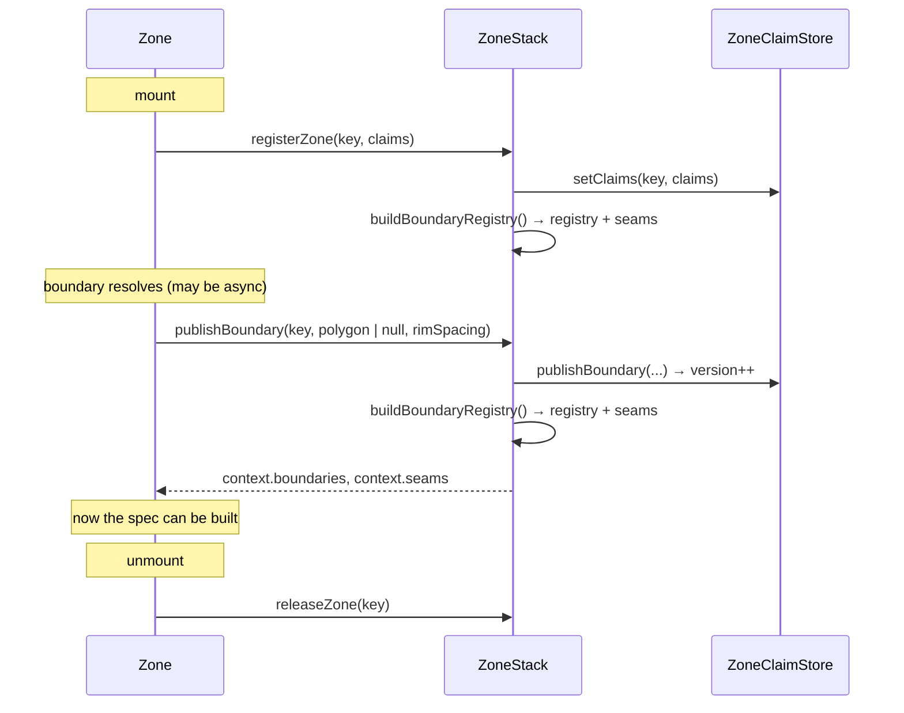
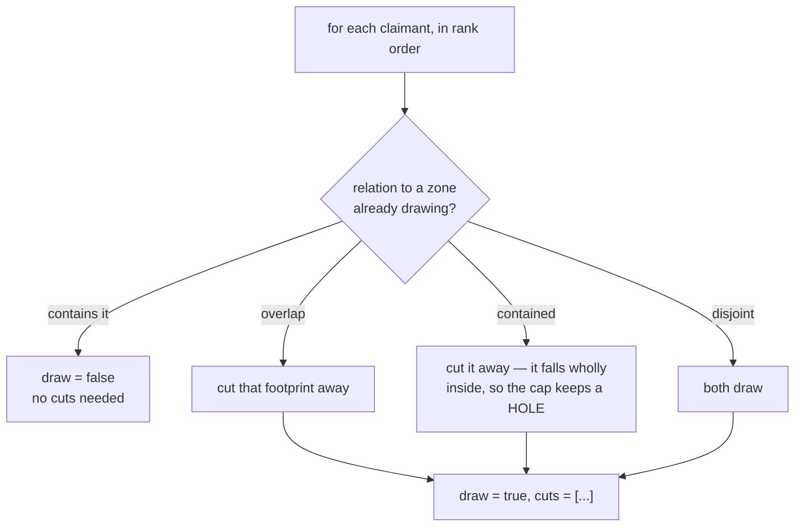
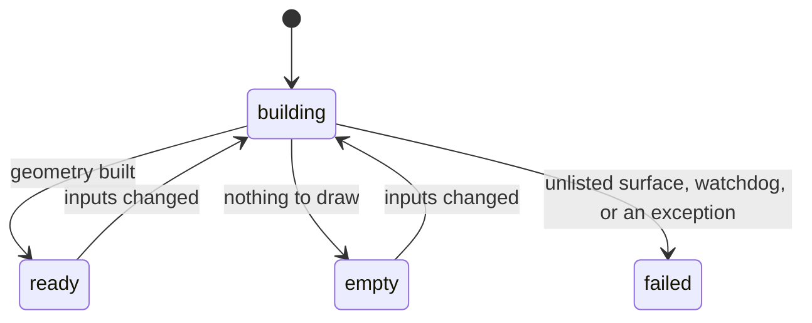

# Coordination between zones

Zones are independent siblings. They cannot see each other, yet three questions
can only be answered by looking at a neighbour:

1. *Do I draw this horizon, or does the zone next to me?*
2. *My top layer was truncated against a surface I do not draw — is anything
   actually standing in for it?*
3. *How far along is the whole stack?*

`ZoneStack` brokers all three.

- [The registries](#the-registries)
- [Seams: who draws a shared horizon](#seams-who-draws-a-shared-horizon)
- [Cover above](#cover-above)
- [The four gates](#the-four-gates)
- [Build state and progress](#build-state-and-progress)
- [The margin ramp](#the-margin-ramp)

---

## The registries



`zone-boundary-registry.ts` holds this as **pure functions over a plain store**,
unit-tested in `tests/zone-boundary-registry.test.ts`. The store has two maps with
**deliberately different lifetimes**:

```ts
type ZoneClaimStore = {
  claims:   Map<string, ZoneSurfaceClaim[]>;   // what each zone declares
  boundaries: Map<string, SettledBoundary>;        // what each zone settled on
};
```

> ⚠️⚠️ **`clearClaims` must not touch the boundary.** Claims change whenever a
> zone's layers do, so the deregistration cleanup runs on a *re-registration* as
> often as on an unmount. Publishing the boundary is a **different effect**, keyed on
> the boundary, which would not re-run — so clearing the boundary there leaves it
> unresolved forever, and every zone sharing one of that zone's horizons waits on
> it for good.
>
> This shipped once. The symptom was a silent stall: progress frozen at, say,
> "3/5 60%", no error, no worker running. The trace that proved it was
> `register k / publish k / unregister k / register k` with no second publish.
>
> `releaseZone` — a separate context callback — drops both, and `Zone` calls it
> from an **empty-dep effect through a ref**, so it fires on unmount only.

### Claims

```ts
type ZoneSurfaceClaim = {
  id: string;
  top: boolean;   // this surface is the zone's LID
};
```

`top` is `i === 0 && zoneLayerFill(layer)` — **both halves matter**. A cap is the
lid of the block *underneath* it, so a zone whose first layer is a bare sheet has
no block for it to be the lid of. Claiming it anyway lets a translucent sheet take
the horizon away from the solid block below, which is precisely the failure the
rule exists to prevent. (`top: i === 0` alone shipped once; removing a layer from a
story shifted an index and silently flipped seam ownership, so a zone's inner
walls showed through.)

Only **real surfaces** take part. A synthetic plane belongs to no column, nothing
can be truncated against it there, and no neighbour can be drawing the same one.
The **carrier** is the exception: it is claimed under `CARRIER_SEAM_ID`
(`'@carrier'`) because it is one plane shared by every zone whose last layer has a
fill.

### Entries

```ts
type ZoneBoundaryEntry = {
  key: string;
  version: number;     // bumped when this zone publishes a DIFFERENT footprint
  resolved: boolean;
  polygon: PlanarPolygonGeometry | null;
  rimSpacing?: number;
  top: boolean;
};
```

Three states, and telling the last two apart is essential:

| State | Meaning | What a waiting zone should do |
|-------|---------|-------------------------------|
| not in the map at all | nobody claims that surface | proceed — there is nothing to share |
| `resolved: false` | claimed, boundary still coming | **wait** — one render, versus a second full build |
| `resolved: true, polygon: null` | resolved to no footprint at all | **proceed** — it will never be anything |

> ⚠️ Mixing the last two hangs every zone beneath a zone whose wellbore outline
> no well reaches. That case is real and reachable on the demo data.

`version` exists because the registry is rebuilt **whole** on every publish, so its
identity churns whenever any sibling settles. A zone consuming a neighbour's
footprint as a *cut* needs a content key it can memoise on:

```ts
const seamsKey = seamIds.map(id => {
  const d = stack.seams?.get(id)?.get(registryKey);
  if (!d) return '';
  return `${d.draw ? 1 : 0}/${d.cuts.map(c => `${c.key}@${c.version}`).join('+')}`;
}).join(',');
```

---

## Seams: who draws a shared horizon

Two zones that meet **share their horizon**: the water/seabed zone's
base *is* the detail zone's top. That is the point — the tiers touch by
construction, with no gap and no fill to invent. The only problem is that the
surface is claimed twice, and drawing it twice means two independent tessellations
fighting for the same pixels.

`resolveSeam(claims)` in `seams.ts` settles it **from the footprints**. Claimants
are ranked:

1. **lid owner first** (`top`), then
2. **area descending**, then
3. **key** (so ties are deterministic).

and each draws its own footprint minus everything already taken:



> ⭐ **The lid rule, and why it matters beyond the feature.** A horizon belongs to
> the zone it is the *lid* of, because a cap is the lid of the block underneath it
> — drawing it with that block's own material and opacity is what stops a
> translucent tier putting a see-through lid on an opaque one.
>
> An earlier version ranked by **area** alone. Draw and appearance then disagreed
> about the owner, which is the only reason appearance ever had to be published
> across a component boundary — and that channel produced a real bug (a seabed drawn
> at the *water* zone's 0.45 opacity, because a layer naming no opacity means
> "my zone's" and the wrong zone resolved it). Making draw follow the same owner
> made appearance **purely local**, and the whole cross-zone appearance channel was
> deleted.

A horizon that is nobody's lid — the carrier, typically — has no owner, which
leaves the area order: the widest draws it and the others cut around it. Two
identical boundaries read as containment, so the tie is deterministic.

### How a cut is applied

`SeamDecision.cuts` become `SurfaceZoneSpec.cuts`, referenced per layer by
`capCuts`. In the worker they are densified with **their owner's `rimSpacing`** and
constrained into the tessellation, so the area the neighbour also covers is bounded
by real mesh edges rather than cut at triangle resolution. With both zones
sampling the same reference grid, the seam is then **watertight**, not merely close.

> ⚠️ Densifying a cut with the *wrong* spacing puts the two boundaries on different
> points of the reference grid, and the seam opens a hairline crack. This is why
> `rimSpacing` travels with the footprint through the registry, the seam decision
> and the spec.

The residual, which is accepted: a detail zone's walls meet a wider zone's cap
across **two different tessellations**, so they agree only within `maxError`. No
z-fighting (only one surface is drawn), but a hairline is possible at grazing
angles.

`SurfaceZoneLayerDiagnostics.capped` and `.droppedExcluded` report the outcome,
and `constraintFailures` should be 0.

---

## Cover above

A zone's **top layer** is truncated against the surface above it in the column —
a surface a *neighbouring* zone draws, with its own (different) boundary.

Dropping the truncated fragments is right where that neighbour covers the spot (two
coincident surfaces from two independent tessellations z-fight) and **wrong** where
it does not: there is nothing to fight with, and the drop leaves a hole into the
block.

`Zone` therefore looks up the surface above its own top in the column, finds who
draws it, and passes that footprint as `SurfaceZoneSpec.coverAbove`. The top
layer's absence then applies only *inside* it. Only the top layer is affected —
every deeper layer's coincident partner is drawn by this same zone with this same
boundary, so it is always covered.

> ⚠️ Several zones can draw parts of that horizon, and only one polygon fits in the
> spec, so the **widest** is used. `SurfaceZoneDiagnostics.topKept` measures how
> many vertices this saved; on real data it is ~0. This is **insurance, not a
> visible fix** — boundaries usually nest.

---

## The four gates

`Zone`'s `spec` memo returns `null` — and the zone does not build — while any of
these holds:

| Gate | Meaning | Settles in |
|------|---------|-----------|
| `!boundarySettled` | a wellbore outline is still resolving | real I/O; **not** watchdogged |
| `coverAbove.pending` | the zone above has registered but not published | a few frames |
| `seamsPending` | a surface claimed by >1 zone has an unresolved claimant | a few frames |
| `columnPending` | this zone's own claims have not reached `stack.column` yet | a few frames |

`columnPending` deserves a note: the stack builds its column from the surfaces its
zones **claim**, and claims are registered in an effect — so on the first render
the column is empty for everyone. Without the wait, every zone would build once
against a column missing its own layers and then rebuild.

The last three are pure bookkeeping between siblings. **None of the slow work
happens behind them**, so a gate still closed after `STALL_TIMEOUT_MS` (15 s) is a
deadlock, not a slow load — the watchdog reports `'failed'` and logs which gate is
still pending. `!boundarySettled` is deliberately *not* watchdogged; it has its own
`.catch(() => settle(null))`.

> ⚠️ **Every early return in the boundary effect must settle.** An unsettled boundary
> blocks this zone *and* anything waiting on it, permanently, with no error. This
> shipped once: the effect took its depth window from `layers[0].surface`, which is
> `undefined` for a synthetic layer, and returned without settling. The symptom was
> "Building 0/1" forever.

A separate, non-waiting failure: a layer naming a surface the stack's `surfaces`
does not contain can **never** enter the column, so `columnPending` would wait
forever. That is a caller error and is knowable immediately, so it is reported as
`'failed'` at once with a console error naming the offending ids.

---

## Build state and progress



`'building'` covers boundary resolution, waiting for a neighbour, **and** the worker
build, because from the outside they are the same thing: not ready yet.

> ⭐ **`'empty'` is an outcome, not a failure.** A zone whose wellbore outline no
> well reaches, or whose footprint is cut away entirely because no surface is
> mapped there, has nothing to draw. Without a distinct state the progress bar hangs
> at 75% forever.

`ZoneStack.onProgress` aggregates the same signal:

```ts
type ZoneStackProgress = {
  total: number;      // zones mounted
  building: number;
  completed: number;  // reached ready | empty | failed
  failed: number;     // of which failed
  fraction: number;
  estimate: number;   // weighted whole-build estimate, mean over zones
  current?: ZoneBuildProgress; // latest step of a zone still building
  zones: ZoneProgressEntry[]; // per zone, mount order (below)
};
```

A `ZoneProgressEntry` carries `key`, `index`, `name?`, `state`, `step?` and
`estimate`, plus what its latest build counted, measured and took:

- `counts` — the last `total` each step reported (surfaces fetched, layers refined,
  pinch-out pairs, tiles, caps), kept once the build is done. ⚠️ The shared
  column's steps appear only when this build ran them, not when the column came
  from cache.
- `metrics` — the zone's `SurfaceZoneMetrics` once it is `ready` (triangles,
  layers, tiling; the phase timings only with `diagnostics`).
- `startedAt` / `finishedAt` — `performance.now()` at the build's start and end.

A rebuild clears them, and the aggregation passes `metrics` only for a `ready`
zone and `finishedAt` only for a finished one, so a rebuild never shows the last
build's numbers.

`ZoneProps.name` labels a zone in `zones` (and its Object3D group). The stack
reports again when a zone is released, and once more with NO zones when the stack
itself unmounts — so anything listening never stays "building" after the stack is
gone. Zones releasing after that final report are ignored.

Two honest caveats:

- **`total` grows as children mount.** The stack cannot know the count earlier, so
  the bar jumps at the very start.
- **`fraction` counts zones, not work.** The first zone of a shared column pays
  for the fetch, the resample and the resolve — roughly half the wall clock — so it
  sits near 0 for most of the time and then sprints. What moves WITHIN a zone is
  `current`: the step it is on, counted in that step's own units (surfaces fetched,
  layers refined, tiles triangulated, caps received). `estimate` is the smooth
  number, but its step weights are a guess (see
  [streaming.md](./streaming.md#the-estimate)).

> ⚠️ A zone that returns `null` never fires `onBuild`. Total silence looks
> identical to a hang — wire `onBuildStateChange` (or `onProgress`) to tell them
> apart.

### Showing progress in the host

The stack lives inside the R3F canvas; a progress display belongs in the host's DOM.
Report it to a source of a `ProgressStore` (see [progress.md](../progress.md), which
covers the store and its displays for every source) through `zoneProgressReport`. It
makes each zone an item:

- its step in words, from `ZONE_PROGRESS_LABELS.phases`, overridable piecewise (e.g.
  `{ phases: { fetch: 'Henter flater' } }`), and with a count (`3/16`) when the step has
  several units;
- named by `ZoneProps.name`, or by position (`Zone 2`, `labels.zone`);
- `tiles` (once tessellated) and `triangles` (once ready) as stats, which a display sums
  once the build is done;
- and the zone whose step was reported last as the one heading the display.

```tsx
const progress = useMemo(createProgressStore, []);
const model = progress.source('model', { name: 'Model', title: 'Building model' });
const onProgress = useCallback(
  (p: ZoneStackProgress) => model(zoneProgressReport(p)),
  [model],
);
// inside the canvas
<ZoneStack onProgress={onProgress}>…</ZoneStack>
// anywhere in the host's DOM
<ProgressPopup store={progress} details={{ stage: true, rows: true }} />
```

Only what reads the store re-renders: passing `setState` to `onProgress` instead would
re-render the whole `<Canvas>` on every report.

The `FieldColumn` story shows it (`progressDisplay`), and in `WithScenery` next to the sky's
own progress (`progressSplit`); its output panel keeps only a `Building zones` /
`Zones built` / `Error` status, the rebuild count and the time.
---

## The margin ramp

Only relevant to wellbore-derived boundaries in `'above'` / `'below'` mode (see
[boundaries.md](./boundaries.md)).

A zone accumulating trajectory from *outside* its own depth window must buffer
each depth interval with the margin of the zone that **owns** that interval — not
with its own. So it needs its neighbours' margins.

Each zone publishes `{ key, topSurfaceId, baseSurfaceId, radius }` via
`publishMargin`; the stack sorts them **shallow → deep by the column** (a caller may
declare zones in any order, and the ramp is a property of depth) and republishes
as `context.margins`.

Like `column`, the ramp is empty until children have registered, so a zone waits
for **its own entry** to appear before building — otherwise it builds against a
half-registered ramp.
